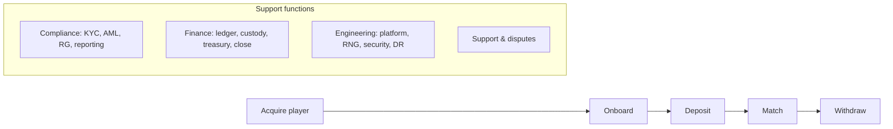

# Process map

## L0 – value chain

## L1 – end-to-end flows (one L2 description each)

| # | Flow | Owner | L2 file |
|---|------|-------|---------|
| 1 | Player onboarding (registration, 18+, geo, KYC triggers) | A4 | `l2/onboarding.md` |
| 2 | Deposit (crypto; fiat adapter) | A5 | `l2/deposit.md` |
| 3 | Match (queue, escrow, seeds, play, settle, reveal) | A3 | `l2/match.md` |
| 4 | Withdrawal (policy, KYC trigger, TAP, custody, travel rule) | A5 | `l2/withdrawal.md` |
| 5 | KYC manual review and case closure | A4 | `l2/kyc-review.md` |
| 6 | Regulatory reporting (SAR, CTR, AOFA periodic, incidents) | A4 | `l2/regulatory-reporting.md` |
| 7 | Month-end close (both entities, crypto accounting, intercompany) | A5 | `l2/month-end-close.md` |

Each L2 file uses `docs/templates/process-l2-template.md`; each manual or hybrid step gets a
runbook in `runbooks/` using `docs/templates/runbook-template.md`.
